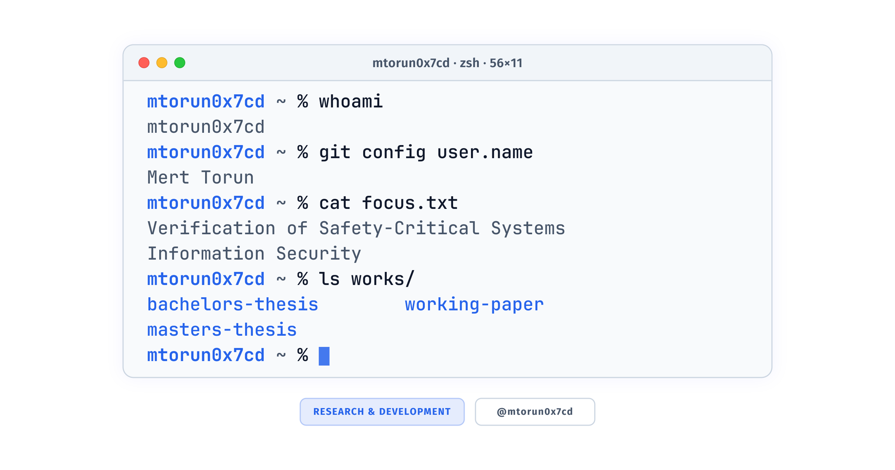

<p align="center">
  <picture>
    <source media="(prefers-color-scheme: dark)" srcset="docs/social_preview_dark.png" />
    <source media="(prefers-color-scheme: light)" srcset="docs/social_preview_light.png" />
    
  </picture>
</p>

# Mert Torun, M.Sc. <!-- markdownlint-disable-line MD026 -->

**Verification of Safety-Critical Systems · Information Security** <!-- markdownlint-disable-line MD036 -->

My work concerns the conditions under which a system can be trusted: the verification and validation of safety-critical systems, the hardening of enterprise infrastructure, and the construction of cryptographic architectures that establish the integrity and authenticity of digital artifacts. I hold an M.Sc. in Computer Science & Engineering from TH Köln and read these problems through the established assurance literature (functional-safety, software-verification, and security-evaluation standards), treating their methods as a shared vocabulary rather than a checklist. The orienting question across these domains is the same: under what conditions a system's claimed properties can be demonstrated rather than asserted.

A second commitment runs through this work: that engineering claims should be reproducible and independently checkable. I operate self-hosted, privacy-respecting infrastructure end to end and cryptographically sign the commits and tags in the repositories under this account, my email and the documents I issue. I treat reproducibility as a property of the engineering itself, and self-hosting as its consequence: the provenance and integrity of an artifact are only as trustworthy as the chain that produced and serves it.

The repositories below are work under this account, together with the upstream extension I contribute to: the repositories of the works listed under Publications, the conventions the other projects are built to, and archives of completed academic and engineering work, most of them student team projects, among them web platforms, a multi-tier Java desktop application, humanoid robotics, and cryptographic education. The archived projects are preserved as records rather than maintained as living tools, documented so that their methods and results remain legible after the work has closed.

---

## Publications

- **Ensuring Functional Equivalence in Retrofitted Anti-Skid Systems for European Public Transportation: A Hybrid Two-Layer Verification Methodology.** Working Paper, *Kölner Beiträge zur technischen Informatik*, 2/2026. [https://doi.org/10.57684/COS-1494](https://doi.org/10.57684/COS-1494)
- **Design and Implementation of a Modular Architecture for the Transparent Integration of Containerized Execution Environments for Heterogeneous Open-Source Binaries in OneWare Studio.** Master's thesis, Technische Hochschule Köln, 2026. [https://doi.org/10.57683/EPUB-3597](https://doi.org/10.57683/EPUB-3597)
- **Password- / Keyless authentication.** Bachelor's thesis, Technische Hochschule Köln, 2021, published 2026. [https://doi.org/10.57683/EPUB-3598](https://doi.org/10.57683/EPUB-3598)

---

## Repositories

- **[anti-skid-verification](https://github.com/mtorun0x7cd/anti-skid-verification)**: two-layer functional-equivalence verification for safety-critical FPGA rail retrofits; the repository of the paper listed under Publications.
- **[thesis-fentwums-container-extension](https://github.com/mtorun0x7cd/thesis-fentwums-container-extension)**: the repository of the Master's thesis listed under Publications, with its LaTeX sources, the version of record and the cross-platform evaluation apparatus for the container extension below, benchmarking synthesis, place-and-route and simulation across iCE40 and ECP5 with the upstream sources pinned as submodules.
- **[FEntwumS.ContainerExtension](https://github.com/FEntwumS/FEntwumS.ContainerExtension)**: OneWare Studio plugin that runs FPGA toolchains such as GHDL, Yosys and nextpnr in containers (opt-in per tool, with a native-host fallback) and records the image digest of each run; the extension the Master's thesis evaluates, contributed to the FEntwumS project.
- **[template](https://github.com/mtorun0x7cd/template)**: the project template the repositories here are built to, with the meta-file family, a tokenized README skeleton, and the CI, release and secret-scanning workflows.
- **[component-lending-system](https://github.com/mtorun0x7cd/component-lending-system)**: PHP/MySQL lending platform for an embedded-systems lab, with tiered role-based access and stock recalculated by schema triggers.
- **[coupon-management](https://github.com/mtorun0x7cd/coupon-management)**: Django platform run against two storage engines, with a reproducible PostgreSQL/MongoDB benchmark.
- **[nao-ball-pickup](https://github.com/mtorun0x7cd/nao-ball-pickup)**: vision-guided ball detection and head tracking, with a fixed-pose pickup motion, for the SoftBank NAO 6 humanoid.
- **[raven-one-simulink](https://github.com/mtorun0x7cd/raven-one-simulink)**: educational cryptographic simulator tracing every RSA intermediate step, with a from-scratch MD5 engine (RFC 8017 / RFC 1321); the practical part of the Bachelor's thesis listed under Publications.
- **[warehouse-management-system](https://github.com/mtorun0x7cd/warehouse-management-system)**: multi-tier Java Swing warehouse client over JPA/MySQL.

---

## Cryptographic Verification & Security

The documents I issue, my email, and the commits and tags in the repositories under this account are cryptographically signed, so a recipient can check their integrity and authenticity. Two independent mechanisms are used, each verifiable on its own.

**Documents & email**: official PDF documents and email are signed with an S/MIME certificate. A document signature is detached CMS (RFC 5652): it travels beside the document as `DOCUMENT.p7s`, never inside it, so a PDF reader shows no signature and none is expected. Checked offline with `openssl cms -verify -binary -inform DER -content DOCUMENT -in DOCUMENT.p7s -purpose smimesign -CAfile chain.pem`.

- **Verify**: offline with the command above. The S/MIME certificate is supplied on request to the email address under Contact.
- **`chain.pem`**: the certificate chain of the issuer in PEM, that is the root D-Trust SBR Root CA 1 2022 and the intermediate D-Trust SBR CA 1-22-1 2022. Both also travel inside each `.p7s`, and `openssl pkcs7 -inform DER -in DOCUMENT.p7s -print_certs` lists them; a root taken from there is trusted only after its SHA-256 fingerprint has been compared with an independent source.
- **After expiry**: the command checks the certificate at the current time, so it fails once the certificate has expired on 2027-06-21. To check a signature made before that date, add `-attime` followed by the time of signing in seconds since 1970-01-01 UTC.
- **Certificate fingerprint**: confirm the certificate for `info@mtorun0x7cd.com` (issued by D-Trust SBR CA 1-22-1 2022) against its SHA-256 fingerprint before trusting it:

    ```text
    11:BC:CF:B3:93:93:06:17:E5:95:87:8A:00:B3:82:43:AC:76:13:00:3E:3A:76:0E:98:B2:AA:05:BF:AD:55:A5
    ```

**Code**: commits and tags in the repositories under this account are signed with an SSH key; GitHub renders these as **Verified**.

- **Signing-key fingerprint**: the Ed25519 signing key is published at [`/users/mtorun0x7cd/ssh_signing_keys`](https://api.github.com/users/mtorun0x7cd/ssh_signing_keys); confirm it against its SHA-256 fingerprint:

    ```text
    SHA256:h0XIy0K+hRkQ921LjtoKu/jSPvvlP0r4BiAMuyEPIrI
    ```

---

## Support & Sponsorship

If you find my work valuable, you can support it:

- **[GitHub Sponsors](https://github.com/sponsors/mtorun0x7cd)**: recurring or one-time support.
- **[Buy Me a Coffee](https://buymeacoffee.com/mtorun0x7cd)**: one-time or monthly contribution.
- **Cryptocurrency**:
    <details>
    <summary>View Bitcoin (BTC) &amp; Monero (XMR) Addresses</summary>
    <br>

    **Bitcoin (BTC)**:

    ```text
    bc1qysjvx7h5dcrxvrzj6mpdrccs0qmescrkqrgzsm
    ```

    **Monero (XMR)**:

    ```text
    4397wSjVyk5C7LR2BB3xLUQZeE8M1UBEJhSZ9KRCryFU7HDBZXnSQZHeK4fTUL8FhFXF9cLcTrg9GiY5agqSF7DKKEj8bcP
    ```

    </details>

---

## Contact

**Mert Torun, M.Sc.**: Verification of Safety-Critical Systems · Information Security  
mtorun0x7cd · Research & Development

- **Email**: [info@mtorun0x7cd.com](mailto:info@mtorun0x7cd.com)
- **Website**: [mtorun0x7cd.com](https://mtorun0x7cd.com)
- **LinkedIn**: [linkedin.com/in/mtorun0x7cd](https://www.linkedin.com/in/mtorun0x7cd)
- **ORCID**: [orcid.org/0009-0003-7932-9043](https://orcid.org/0009-0003-7932-9043)
- **GitHub**: [github.com/mtorun0x7cd](https://github.com/mtorun0x7cd)
